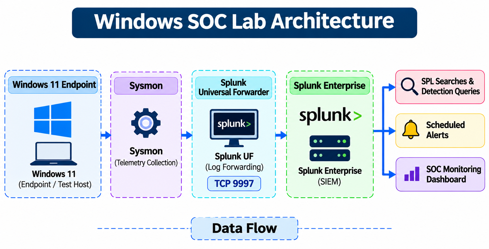

# Lab Architecture

The following diagram illustrates the Windows SOC lab architecture and the flow of security telemetry from the endpoint to Splunk Enterprise.



## Data Flow

```text
Windows 11 Endpoint
        |
        v
      Sysmon
        |
        v
Splunk Universal Forwarder
        | TCP 9997
        v
Splunk Enterprise
        |
        +--> SPL Searches and Detection Queries
        +--> Scheduled Alerts
        +--> SOC Monitoring Dashboard
```
